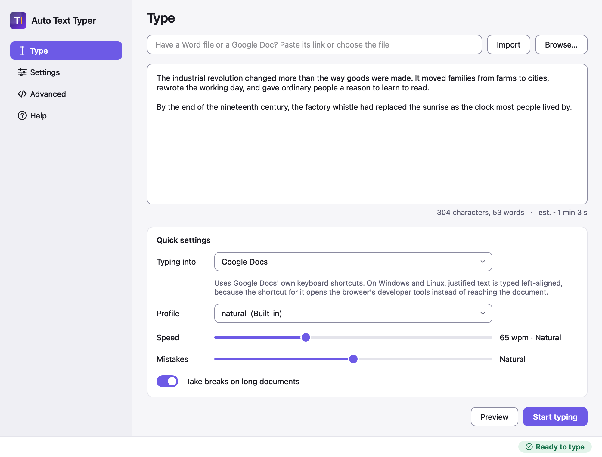

# Auto Text Typer

A desktop app that types text you supply into whatever application has focus
(Google Docs, Word, TextEdit, a web form), with the timing, pauses and
self-corrected mistakes of a real typist. It can also import a Google Doc or a
`.docx` and retype it with its headings, bold, italic and lists.

## What it does

- Types your text through OS-level keystrokes, at a speed you set, with
  natural pauses, occasional mistakes it backspaces and fixes, and breaks on
  long documents.
- Reproduces your text exactly. The output is checked by a test that replays
  the keystrokes over thousands of random seeds ([the guarantee](docs/guarantee.md)).
- **Preview** plans a whole run without typing anything, so you see the
  duration, the mistakes and the breaks first.
- Imports a Google Docs link, `.docx` or HTML export and types its formatting
  using the target editor's own shortcuts. What cannot be typed (images,
  tables, footnotes) is listed before you start, not dropped silently.
- Has global hotkeys, a tray icon, a pause/stop control and a plain-text
  [command line](docs/cli.md).

It does not write anything for you. You supply the text.

## Before you install

Three things you will hit in the first five minutes:

- **macOS 15 (Sequoia) or newer is required.**
- **The macOS app is ad-hoc signed and not notarised.** macOS will refuse to
  open it the first time. Control-click the app, choose **Open**, then **Open**
  again; or go to **System Settings → Privacy & Security** and click **Open
  Anyway**. Details in [Install](docs/install.md#macos).
- **It needs Accessibility permission to type.** Turn on **Auto Text Typer** in
  **System Settings → Privacy & Security → Accessibility**, then quit and
  reopen the app. Details in [Permissions](docs/permissions.md).

The Windows build is unsigned too, so SmartScreen warns on first run
(**More info → Run anyway**).

## Install

Download from the [Releases page](https://github.com/EbMrBeb/Auto-Text-Typer-Universal/releases/latest).

| Platform | File |
|---|---|
| macOS, Apple silicon (M1 or newer) | `AutoTextTyper-<version>-macOS-arm64.dmg` |
| macOS, Intel | `AutoTextTyper-<version>-macOS-x86_64.dmg` |
| Windows (x64) | `AutoTextTyper-<version>-Windows-x64-Setup.exe` |

Linux builds (AppImage and tarball) are also published; they work on X11 but
not Wayland. See [Install](docs/install.md) for every file, and for a
self-test that checks a download works.

## Quick start

1. Install and open the app, and grant Accessibility permission (macOS).
2. Paste your text into the box on the **Type** page.
3. Press **Preview** to see what the run will look like.
4. Press **Start typing**. During the countdown, click into the document or
   field where the text should go.
5. Keep your hands off the keyboard and mouse. Press **Esc** to stop.

Turn off autocorrect in the target application first, or it will rewrite the
text after it lands. See
[how to turn it off](docs/importing.md#turn-off-autocorrect-in-the-target-application).

## Documentation

- [Install](docs/install.md): every download, first-open steps, self-test
- [Permissions](docs/permissions.md): macOS Accessibility, Windows, Linux X11/Wayland
- [Typing, hotkeys and the tray](docs/usage.md)
- [Importing a formatted document](docs/importing.md): Google Docs, `.docx`, the editor picker, what is not reproduced
- [Realism settings](docs/realism.md): profiles and the Advanced page
- [Command line](docs/cli.md)
- [The guarantee](docs/guarantee.md): why the typed text equals your text
- [Building from source](docs/building.md)
- [Contributing](CONTRIBUTING.md)

## Licence

MIT. Copyright (c) 2026 Braxton Gorman. See [LICENSE](LICENSE).
